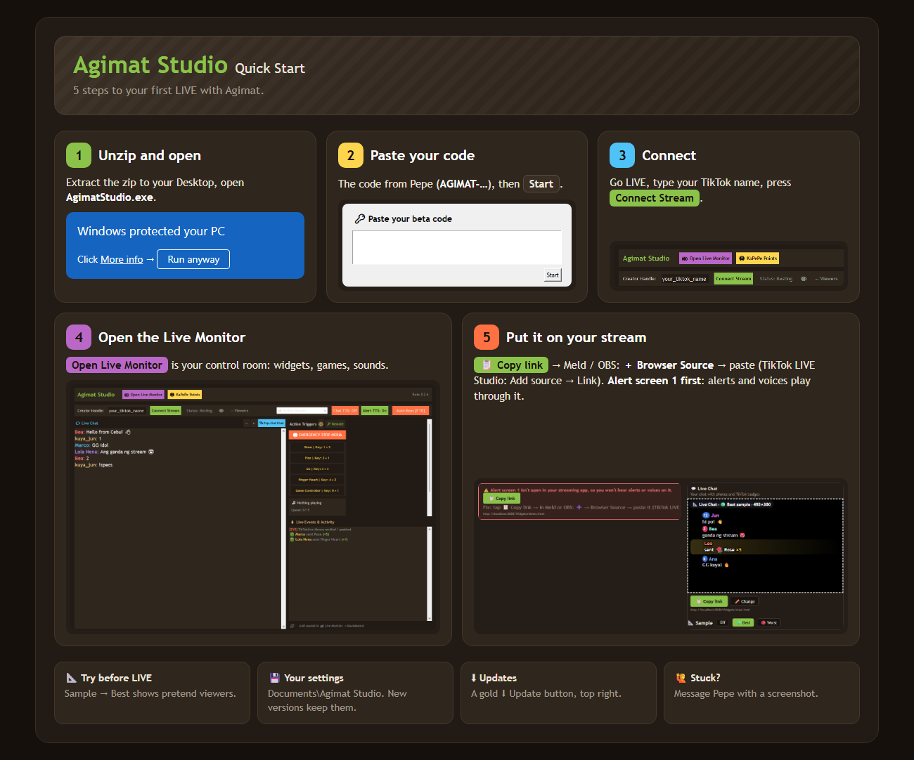

# Agimat Studio · Beta

A TikTok LIVE helper for streamers: live chat with photos, alerts, goals,
shoutouts, polls, a streamathon clock, your socials, and Meld Studio controls.

This is a **private beta**: you need a beta code from Pepe.

## Quick Start
New here? The 5 steps on one page (also in the zip: **Quick Start.html**).

## What's new in 0.2.13
- ⌨️ **Input layers**: show your keys, mouse and controller on stream while you
  play. Three layers, each its own link (Live Monitor → 🎮 Games). A mouse radar
  that works in shooters, Xbox and PlayStation shapes, and ⏸ Keys off for
  passwords.
- 🎨 **4 looks to mix**: Cordillera, Outline, Clean and Chewlabs Supernova
  Intergalactic (salamat, chewlabs, for the idea!). Always see-through.
- On 0.2.6 or newer? The gold ⬇ Update button (top right) downloads this version.

## What's new in 0.2.12
- 👋 **Join shout-outs**: a voice says hi to viewers who join ("Welcome, Juan,
  Ana and Mark!"). Pick the voice, the talk speed and the words; a key turns
  it on and off. Made for busy LIVEs: a few names per line, each viewer once.
- 🎛️ **Pad size**: Soundboard pads in Small, Medium or Large, the same
  everywhere they show.
- ⚔️ **Arena**: a size slider for the KO board (top left).
- 📏 **Laptop screens**: Live Events keeps about 8 lines on a 1366 × 768 screen.

## What's new in 0.2.11
- 🏆 **Win counter**: a Custom Goal you count by hand (great for Souls games):
  big − 1 / + 1 buttons, a key for each, and 3 shapes for every goal: Goal
  bar, Big number and Souls gold.
- 🎨 **New header**: "Agimat Studio" big across the top with Ifugao looks
  (Woven band, Rice terraces, Ikat edge); "Match my theme" picks one for you.
- 💡 **Tips** at the bottom of the window, and now and then **"What should
  Pepe build next?"**: copy your idea and send it to Pepe.

## What's new in 0.2.10
- 🧊 **Freeze fix**: on a long, busy LIVE, Agimat could freeze ("Not
  responding"). Fixed. If it ever freezes again, send Pepe `freeze-log.txt`
  from Documents\Agimat Studio: it says where it got stuck.

## What's new in 0.2.9
- 🖥️ **Desktop overlay**: your chat, live events and pads in their own window
  over your game: always on top, see-through up to 70%, 👻 ghost (clicks go
  through; Ctrl+Shift+O brings it back), and your 👁 viewers on its bar.
- 🧭 **Setup checklist** (Live Monitor → Setup): each layer turns green by
  itself once it's open in your streaming app, and a wrong size says how to
  fix it. "Send my setup to Pepe" copies a note for Pepe.
- 🗿 **Tall Bulul Arena**: its own settings and gifts, an Area (full, top,
  middle or bottom third), and faster floating heads (up to 40).
- 💬 Chat and gifts show up right away.
- 📝 A short **Feedback** tour opens once: copy your answers and send them to
  Pepe. Salamat!

## What's new in 0.2.8
- 🔊 **Gifts play your Soundboard**: up to 3 gifts per pad (once per combo,
  skipped while it still plays), a Gifts on/off switch, and a new 🔊 **Sound
  gifts** layer. 🎁 Quick now puts the gift on the pad, and ✕ clears it.
- 🎛️ **The Soundboard inside Agimat Studio**: Edit mode (name, emoji, key,
  gifts, color, drag to move), and ⌨️ **Keys off** so your number keys type
  normally while you work.
- 🌟 **Spotlight on any alert**: the viewer's TikTok photo and name, big, in
  8 looks (Coin Flip, Tribal Swoosh, Bulul Slam, Spotlight, Trophy, Crown,
  Fireworks, Polaroid).
- 💰 **A new alert: one viewer's coins this LIVE** (every 1,000 coins from the
  same viewer, all their gifts added up).
- 🛠️ **Admin view** for Meld's side panel: your chat on top, live events
  below, with chips to hide joins and more.
- Your TikTok @ is remembered, every button looks the same, and game gift
  lists can be see-through.
- On 0.2.6 or 0.2.7? The gold ⬇ Update button (top right) downloads this version.
- After updating: make your Alert screen layer cover the whole screen (for
  Spotlight), and re-add old Quick gifts with Quick to see them on their pad.

## What's new in 0.2.7
- ⏳ **Streamathon: Survival mode**: every rule can add OR take away time
  (each coin, every 100 taps, follows, shares, gifts you pick), with − / +
  buttons. One click for 🛡️ **Survival rules**: each coin +5 s, every 100
  taps −1 s, Clock max 60 min, Longest stream 4 hours. Plus ⚡ Double time,
  a 🚨 Danger zone under 5:00, gift pictures on the clock, and a new
  **Rules + 🏆 Time keepers** layer.
- 🎁 **A gift list for every game** (Arena, Tug-of-War, Siege, Pong): its
  own layer, as a Card, a Strip or a Spotlight. Each game's gift row inside
  the game is now off: tick "Also show the gifts inside the game" to bring
  it back.
- 🗿 **Bulul Arena**: up to 3 gifts per power, and ➕ **a first follow can
  give a power** (the follower jumps in with +100 health; once per viewer
  per LIVE, so it can't be spammed).
- On 0.2.6? The gold ⬇ Update button (top right) downloads this version.
- After updating: press 🛡️ Survival rules on your Streamathon, add each
  game's 🎁 Gift list layer, and pick what "A first follow gives" in the Arena.

## What's new in 0.2.6
- 🌾 **New game: Tug-of-War (9:16)**: viewers type **1** or **2** to join a
  team of Ifugao fighters on the Banaue rice terraces. Join first: only team
  members' gifts, taps and follows count. Gifts you pick send fighters (Bolo,
  Shield Spearman, Headhunter, Gumayang, Mumbaki, the Bulul boss), the whole
  team's taps fill a swarm bar, and houses shoot arrows. A half-screen link
  too. In Meld: W 1080, H 1920 (half: H 960), Lock size off.
- 🪐 **Bulul Arena: Neutral fight**: heads float like in space, nobody chases,
  taps never shove. Bumps still hurt, powers work as always. Float speed 1-10.
- 📏 **Line up**: Leaderboards left / middle / right, Live Chat left / right,
  and long chat text folds instead of being cut off.
- 🩹 **Games survive a crash**: reopen Agimat in the same LIVE and the teams,
  tap bars and Play are still there; alerts don't fire twice. A new LIVE
  starts fresh. Typing 1 / 2 now works in Tug-of-War even with Pong on.
- ⬇ **Your version, top right**, and a gold **Update** button when a new
  beta is out (it downloads the zip).
- 🔊 **Sound pads open up**: "+13 more" shows all your sounds in the app.
- After updating, refresh your Live Chat, Leaderboard, Bulul Arena and Cliffside Siege sources in Meld / OBS once.

## What's new in 0.2.5
- 🪨 **New game: Cliffside Siege (9:16)**: viewers type **A** or **B** to join
  a team on two night cliffs and throw spears at the other team's bale. Taps
  throw faster; gifts you pick give powers (🔥 torch, 🔫 gun, 🚀 bazooka,
  🗡️ blades, 🌩️ Wrath of the Mumbaki). Your own team names and colours
  (Ifugao vs Kalinga to start). Potato Mode for slower PCs. In Meld:
  W 1080, H 1920, Lock size off.
- ⏳ **More timers**: press ➕ Add a timer for up to 8 countdowns, each in its
  own box with its own name, link, key (start / pause / resume), rules and
  look. At 0:00 a timer can play a Soundboard sound and switch to a scene.
- 🗿 **Bulul Arena gift combos**: the first gift turns the power on; more of
  that gift while it's on = **+80 health per coin** (Rose ×29 = the saw +
  2,240 health).
- 🎯 **Goals keep their count** when Agimat restarts in the middle of a LIVE,
  and each goal has a **Count now** box to type a count by hand.
- After updating, refresh your Alerts, Streamathon, Bulul Arena and Pepeng Pong sources in Meld / OBS once.

## What's new in 0.2.4
- 🗿 **Bulul Arena 3.0**: the number on each player is their taps = their
  health (0 = KO), up to **100 players**, a Fight setting (Calm / Normal /
  Aggressive), and **six gift power-ups** that charge first and can be
  combined: 🌀 black hole, 🦈 saw blade, 🗡️ lightsaber, 🔫 gun, ⚡ lightning,
  💀 skull wave.
- 📱 **A tall 9:16 arena link** for phone-shaped streams. In Meld, set that
  layer to W 1080, H 1920 and turn **Lock size off**.
- 👀 **The Live Monitor opens in its own Agimat window** (or your browser:
  Settings → Live Monitor opens in).
- 🔊 **Sound pads inside the app** and the Magic Remote: a 3×3 grid of your
  first 9 sounds, placed where you like (Settings → Sound pads).
- 🎨 **Calm themes** (Tala Slate, Charcoal, Sage, Light) for both windows,
  and a Words / Icons switch in the Live Monitor.
- After updating, refresh your Alerts, Bulul Arena and Pepeng Pong sources in Meld / OBS once.

## What's new in 0.2.3
- ⌨️ **Sound keys that work**: numpad keys and F-keys alone (Numpad 1 is
  its own key), a held key in your game no longer stops them, press a
  sound's key again to stop it, and a key for ⏹ Stop all.
- 🏓 **Pepeng Pong**: teams stay every round, no more stutter when the ball
  pops lots of dots, and a 🏅 leaderboard per team (sides, under the game or
  corners; Top 3 / 5 / 10) plus "Pepe +10" pop-ups with the viewer's picture.
- ⚡ **No more double alerts**: a pop-up when a gift already does something
  (Play both / Replace / Cancel), and a Gift list showing what each gift does.
- 🗂️ **Profiles**: keep setups like "Podcast" and "Games", and switch at the
  top of the Live Monitor, even mid-stream.
- 💾 Safer saving: a crash can't leave half a settings file.
- After updating, refresh your Alerts and Pepeng Pong sources in Meld / OBS once.

## What's new in 0.2.2
- 🏓 **Pepeng Pong**, a team game: viewers join a team by typing its number
  or name, gifts and taps drop dots, and the ball pops them for points.
  Play / Stop / Reset, or "Play indefinitely" for AFK streams.
  Live Monitor → Games.

## What's new in 0.2.1
- 🗿 **Bulul Arena 2.0**: a fairer fight, 3 gift power-ups (spinning
  lightsaber, gun, electric shockwave), KO score with a Top KOs board, and
  4 / 8 / 12 / 16 heads.
- 🏆 Leaderboards are see-through, and rows keep the same size.

## What's new in 0.2
- 📐 **Samples**: every widget box in the Live Monitor has a Sample button
  (Off / 🟢 Best / 🔴 Worst). Worst shows the biggest case (the longest
  comment and name, a full Top 10…), Best a normal-looking stream, with a
  dashed outline, so you can size and style it in your streaming app.
  Connect turns them all off; while LIVE a sample lasts 8 seconds.
- 🗂️ **Live Monitor tabs**: Setup · Alerts & gifts · Goals & timer · Chat &
  banners · Games & stats. The Soundboard stays on the right.
- 🏆 **Leaderboards**: ❤️ Top Likers, 🎁 Top Gifts and ⭐ Top Points, each its
  own source, plus one 🏆 Leaderboard that takes turns between them.
- 🗿 **Bulul Arena fights**: size is health. Taps make a head bigger and
  angrier, bumps hurt, and a head that shrinks away is 💥 KO'd until that
  viewer taps again.
- 🎁 **Gift pickers with pictures**: search a gift by name, or filter by price.
- 👁️ **Viewers**: "124 watching · 1,532 came this stream".
- 🎁 **Gift Menu**: shows viewers which gifts do something on your stream.
  Pick a look: belt, spotlight or menu board.
- 📢 **Megaphones 1–4**: your own lines, with chat words (a viewer types
  `!specs` and the Megaphone jumps to that line). Your old Megaphone link is
  Megaphone 1, and your Game and Specs moved into it.
- 🗣️ **Alert TTS on/off**: a button for alerts' read-aloud lines, next to
  Chat TTS.
- 🎉 **9 confetti styles**: party poppers, fireworks, balloons, hearts,
  ribbons, sparkles, your own emoji, and a rain of the gift that was sent.
  Each alert can pick its own; pick colours and how much.
- 🎵 **Easier Spotify setup**: step-by-step buttons in the Music Bot tab, and
  a red warning while it isn't connected.
- 🎵 **Song requests**: paid with KaPePe points, a gift (each one = 1 song
  token) or free, with a limit on songs waiting per viewer.
- 🎛️ Soundboard key combos (e.g. Ctrl+1) · new sounds start at 50 % volume
  · Live Chat 10/15/20 lines · hide a goal with "Show on stream" · Bulul
  Arena stay time · TTS skips emoji · new installs can pick gifts right away.
- ⚠️ A red warning in the Live Monitor when **Alert screen 1** isn't on your
  stream (that's why some of you couldn't hear the TTS test).

## 1. Download
Open **Releases** (right side of this page) → the **newest** one at the top →
download the **AgimatStudio-Beta-….zip** file. The version is in the app's
title bar (e.g. "Agimat Studio Beta 0.2.0").

## 2. Unzip
Right-click the zip → **Extract All** → choose your **Desktop** (or Documents).
Not Program Files. Open the folder and double-click **AgimatStudio.exe**.

## 3. "Windows protected your PC"
Windows shows this for new apps that aren't signed (signing costs money).
Click **More info** → **Run anyway**. Some antivirus apps complain too,
because Agimat listens for your hotkeys; if yours blocks it, allow
AgimatStudio.exe.

## 4. Paste your code
Copy the whole code Pepe sent you (it starts with `AGIMAT-`), paste it, press
**Start**. The top of the window shows how many days you have left. When it
runs out, ask Pepe for a new code: your settings are kept.

## 5. Connect
Type your TikTok name (no @) and press **Connect Stream** while you're LIVE.

## 6. Put it on stream
Open **http://localhost:8000/monitor.html** in your browser: that's your
Live Monitor. Open a tab, press **📋 Copy link** on the box you want,
then add it to your streaming app:
- **Meld Studio** or **OBS**: add a **Browser Source** with that link.
- **TikTok LIVE Studio**: **Add source → Link** and paste it.

**Always add Alert screen 1** (Live Monitor → **🎬 Setup** tab →
Alert screens → Screen 1 → 📋 Copy link), and keep it in every scene. Alert sounds, videos
and the voice reading your chat all play through it. Without it you hear
nothing. The Live Monitor shows a red warning until it's there.

## 7. Scene buttons (Meld Studio or OBS)
In the Live Monitor's **🎬 Streaming app** box, pick the app you stream with.
- **Meld Studio**: in Meld, **Settings → Advanced → WebSocket Server** on.
- **OBS (version 30 or newer)**: in OBS, **Tools → WebSocket Server Settings**
  → tick **Enable WebSocket server** → **Show Connect Info** → copy the
  **Server Password** and paste it in the box.

You get your scene buttons (the live one lights up), mic mute, record, and
the streamathon can switch to your ending scene. TikTok LIVE Studio has no
remote control, so it gets everything except scene buttons.

## 8. Spotify (optional)
You need **Spotify Premium** (Spotify's rule for apps like this, and for
controlling playback). The app's **⚙️ Settings → 🎵 Music Bot** tab walks
you through these steps with buttons.
1. Go to **developer.spotify.com/dashboard**, log in, **Create app**.
2. Any name. Redirect URI, exactly: `http://127.0.0.1:8000/spotify/callback`
   (the numbers, not "localhost"). Tick **Web API**. Save.
3. Open the app's **Settings**: copy the **Client ID** and **Client secret**.
4. In Agimat's **Music Bot** tab, paste both and connect.

Keep your Client secret private, like a password.

## Your files
Settings, media and data are in **Documents\Agimat Studio**. New version:
delete the old AgimatStudio folder and unzip the new one; your settings stay.

## Privacy
Agimat runs on your PC. It talks to TikTok (through the TikTokLive library
and the connection service it uses), and to Spotify, Meld or OBS only if you
connect them. Your OBS password stays on your PC. The widget pages can only
be opened on your own PC.

## Problems or ideas?
Message Pepe with a screenshot.
